### https://dev01.ezapps.co.kr/

## 테스트 계정

- `admin@test.com` / test1234 (관리자) /
  7d689f31b3863e3d7250e32fba9991d9bb15f03d34d2774ce9220402c45e2167
- `test_2@test.com` / test1234 / 7e63def7ea7262631ba2807aafdbb0cbbb5891d436a791157a2d3f95485f8230
- `test@test.com` / test1234 / a5cf7970501e18af6e427ca240af23f5d65bb435f2dd7f4b239a084cfb45e740

## 변경점

- **게시판**
  - 장르별 게시판
  - 비밀번호로 접근하는 비밀 게시판
  - 제목 검색
- **게시글**
  - 최근 본 게시글 기록
  - 로그인 없이 메인 페이지 열람
  - 목록에 좋아요 수와 댓글 수 표시
  - 내가 누른 좋아요 표시
  - 게시글 신고
- **이미지**
  - 드래그앤드롭으로 이미지 순서 변경
  - 여러 이미지 한 번에 첨부
- **관리자**
  - 게시판, 게시글 관리
  - 신고 확인 및 처리
  - 게시글 엑셀 다운로드

## 작업 요약

### 게시판

- 게시판별 색 지정
- 게시판별 게시글 조회 가능

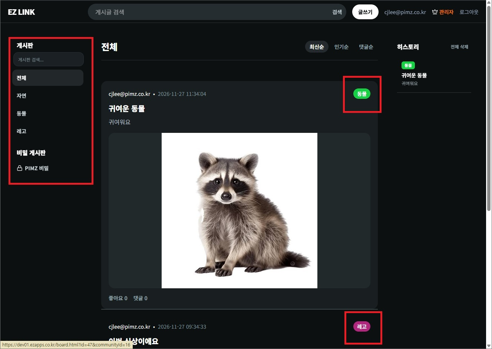

---

### 비밀 게시판

- 비밀번호를 입력해야 입장 가능
- 입력한 비밀번호는 Session storage에 저장

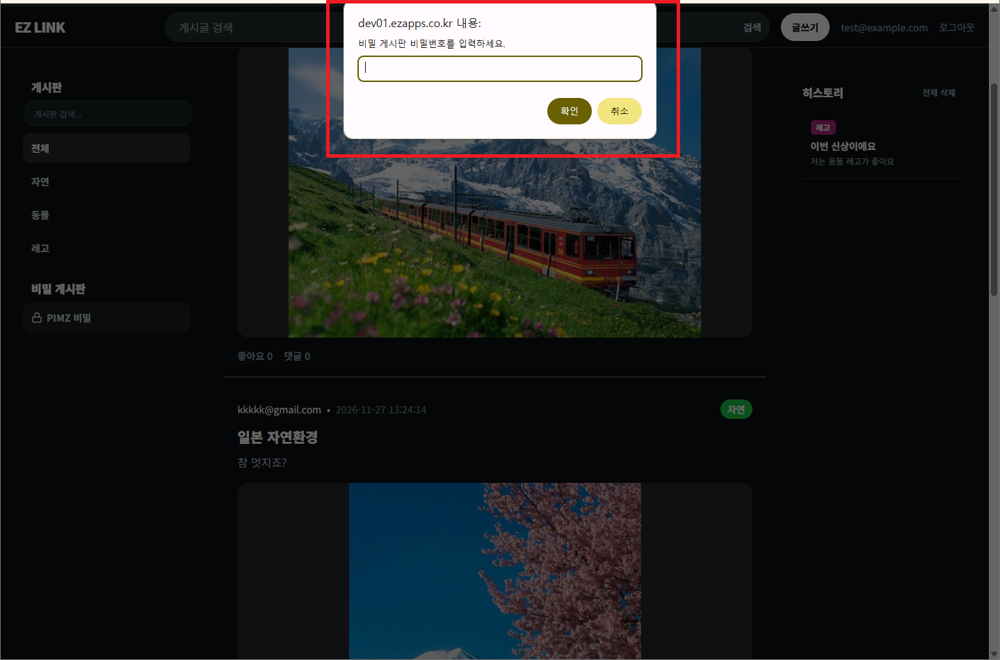

---

### 히스토리

- 게스트와 유저가 방문 기록을 Local storage에 저장
- 게시글 클릭시 해당 게시글로 이동

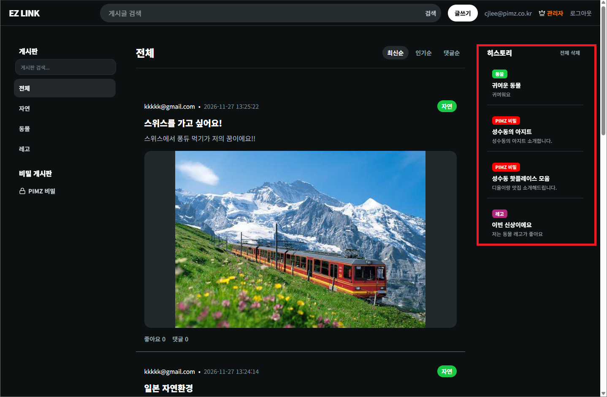

---

### 메인페이지

- 로그인 없이 게스트가 게시글 보기 가능
- 게스트가 비밀 게시글, 글쓰기 클릭 시 로그인 유도
  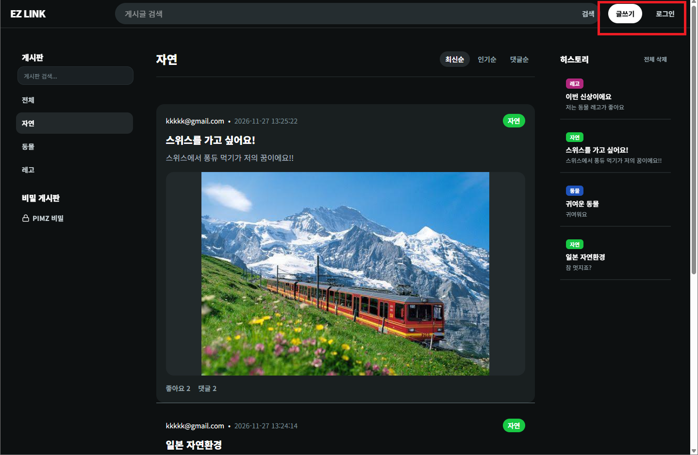

- 게시판별 검색기능
  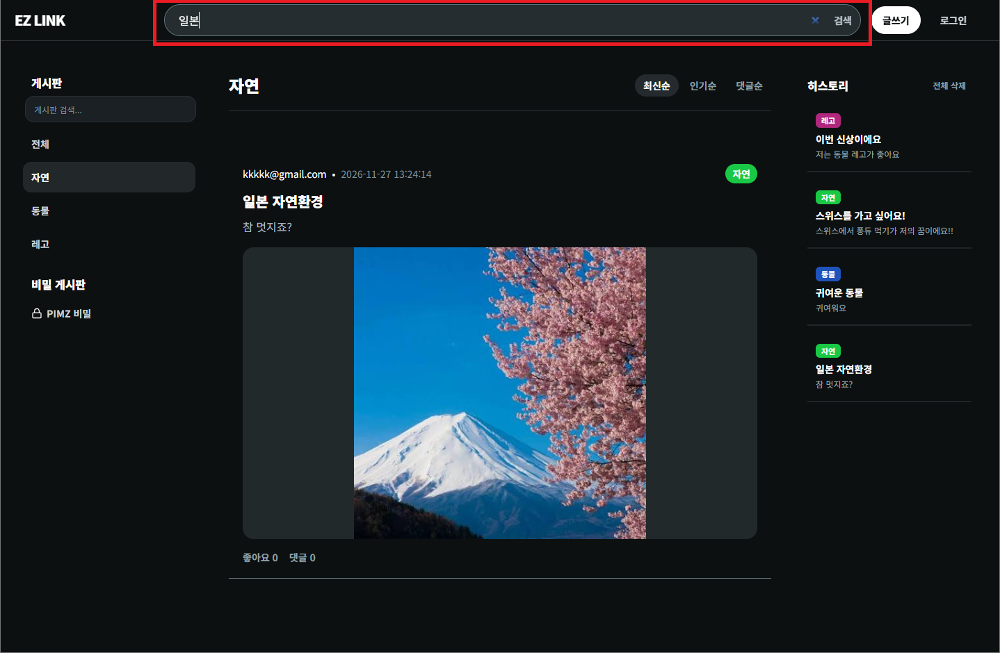

---

### 좋아요, 댓글

- 게시글 미리보기에 댓글, 좋아요 추가
  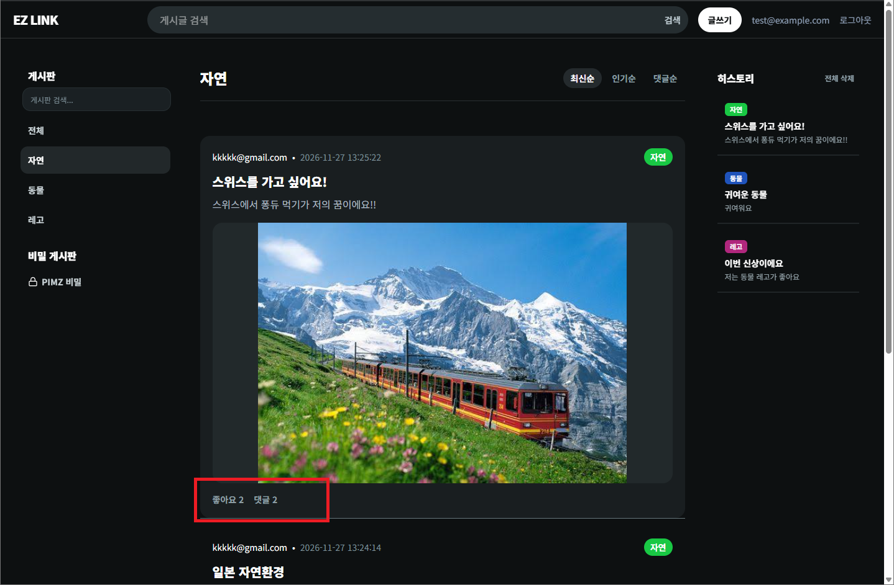

- 내가 누른 좋아요는 확인 가능
- 여러번 버튼을 누를경우 이력관리를 통해 한번만 시도되도록 설계
- 빠른 조회를 위해 boardId-userId 인덱스 설정
  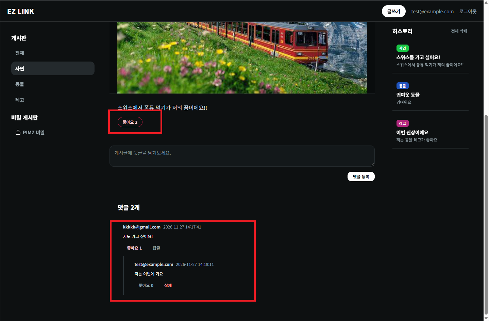

---

### 게시글 옵션

- 수정, 삭제, 신고 메뉴
- 같은 유저가 게시글 여러번 신고해도 한번만 신고
  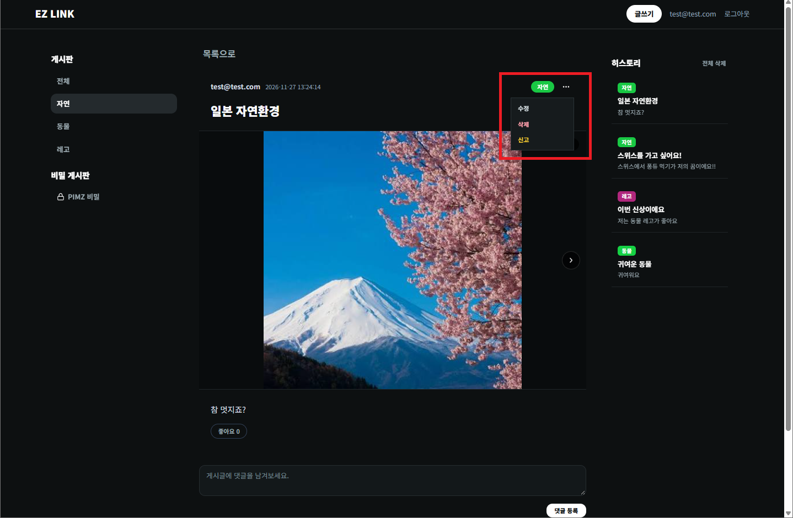

---

### 이미지 드래그 드롭

- 이미지 다중 업로드
- 미리보기에서 드롭다운을 통한 이미지 순서 변경 및 수정

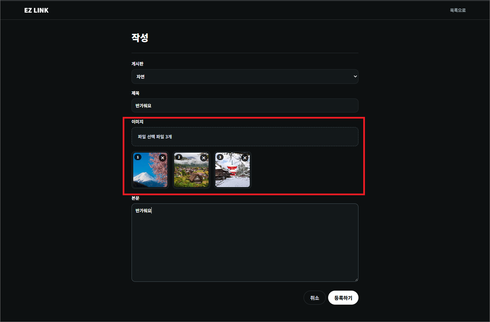

---

### 관리자

- 게시판 생성
  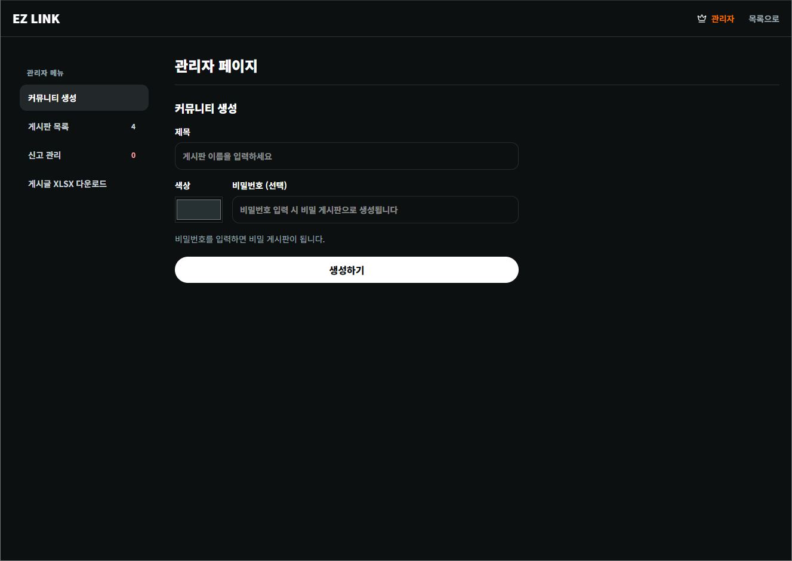

- 게시판 상세 조회 및 삭제
  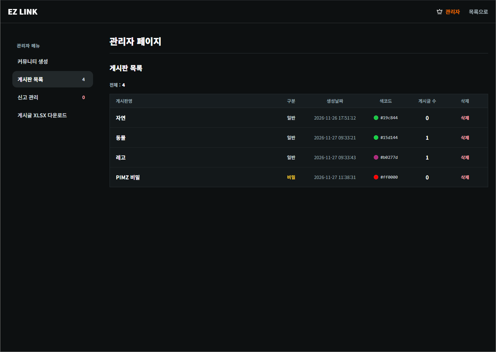

- 신고 관리
  - 신고가 많은 순으로 정렬
  - 신고글 삭제/ 반려 기능

  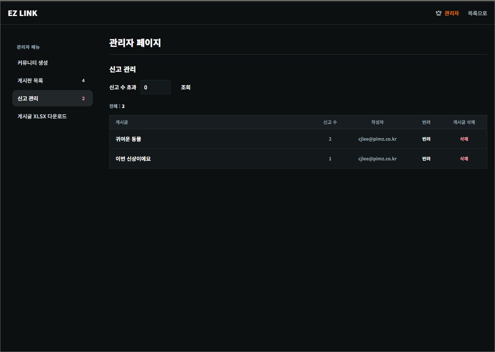

- 게시글 다운로드
  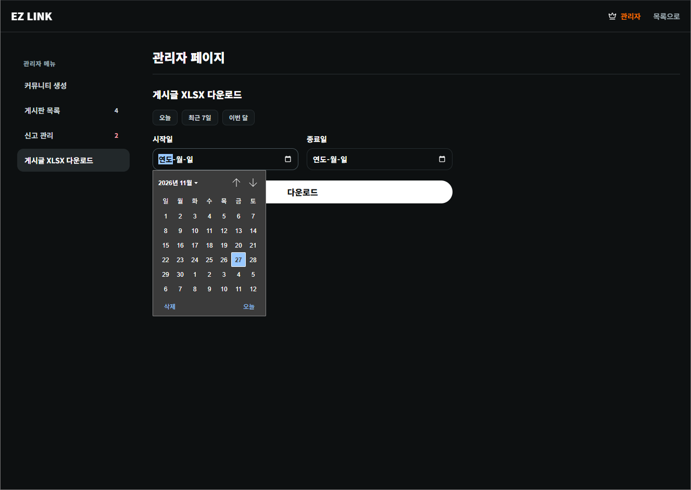

- 추가사항
  - 다른 유저의 게시글 삭제, 수정
  - 다른 유저의 댓글 삭제, 수정
  - 비밀번호 필요 없이 게시글 접근 가능

## 프로젝트 구조

```
src/                                  # 백엔드 PHP 소스 코드
├── admin/                            # (신규) [관리자 기능]
│   ├── controller/
│   │   └── AdminController.php
│   └── repository/
│       └── AdminRepository.php
│
├── auth/                             # [회원 인증/인가]
│   ├── controller/
│   │   └── AuthController.php
│   ├── dto/
│   │   ├── CreateUserDto.php
│   │   └── UserInfoDto.php
│   ├── entity/
│   │   └── UserEntity.php
│   └── repository/
│       └── UserRepository.php
│
├── board/                            # [게시판/커뮤니티 CRUD]
│   ├── controller/
│   │   └── BoardController.php
│   ├── dto/
│   │   ├── BoardDetailDto.php
│   │   └── BoardDto.php
│   └── repository/
│       ├── BoardImageRepository.php
│       ├── BoardRepository.php
│       └── CommunityRepository.php
│
├── comment/                          # [댓글/답글]
│   ├── controller/
│   │   └── CommentController.php
│   ├── dto/
│   │   └── CommentDto.php
│   └── repository/
│       └── CommentRepository.php
│
├── excel/                            # [관리자 엑셀 다운로드]
│   ├── controller/
│   │   └── ExcelController.php
│   ├── dto/
│   │   ├── BoardExcelSheetDto.php
│   │   ├── ExcelBoardDto.php
│   │   └── ExcelCommentDto.php
│   └── repository/
│       └── ExcelRepository.php
│
├── like/                             # (신규) [좋아요 기능]
│   ├── controller/
│   │   └── LikeController.php
│   ├── dto/
│   └── repository/
│       └── LikeRepository.php
│
├── report/                           # (신규) [신고 기능]
│   ├── controller/
│   │   └── ReportController.php
│   └── repository/
│       └── ReportRepository.php
│
└── common/                           # [공통 유틸리티/설정]
    ├── Env.php
    ├── ExceptionHandler.php
    ├── FileHandler.php
    ├── JsonResponse.php
    ├── MySQL.php
    └── Session.php
index.php                             # 백엔드 API 진입점

uploads/                              # 업로드된 이미지 저장 디렉토리

.env                                  # 환경 변수 파일
.gitignore                            # Git 제외 파일 목록

index.html                            # 메인/목록 페이지
admin.html                            # 관리자 페이지
board.html                            # 게시글 상세 및 댓글/답글 페이지
signin.html / signup.html             # 로그인 / 회원가입 페이지
write.html                            # 게시글 작성 페이지
```

## ERD

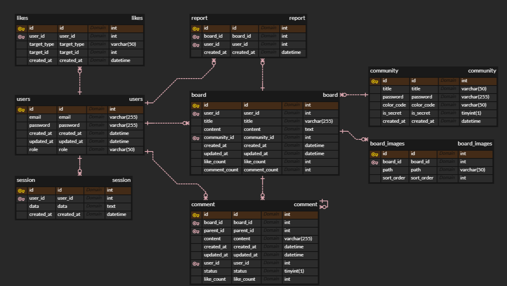
